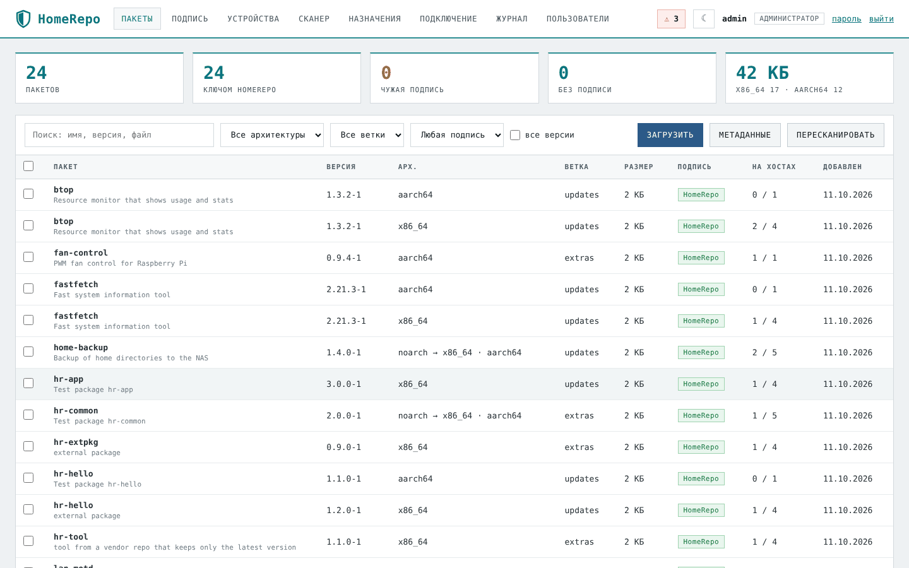
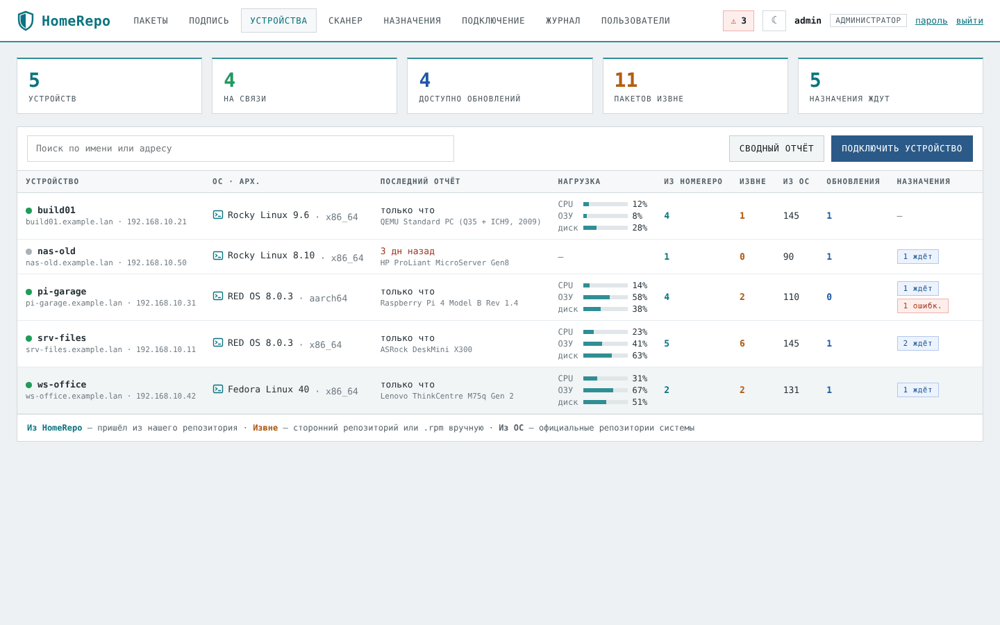
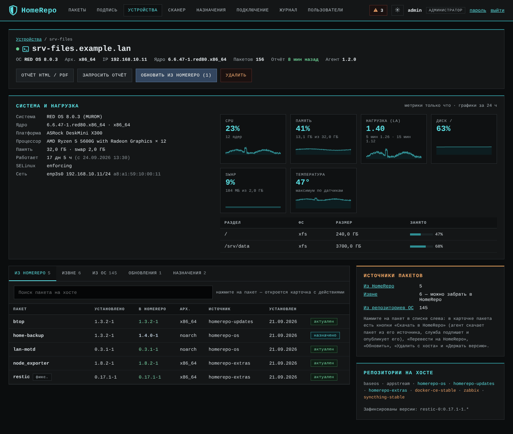

# HomeRepo

Собственный RPM-репозиторий для домашней или небольшой офисной сети на РЕД ОС, Rocky, Alma, Fedora и других системах семейства RHEL. В комплекте:

- веб-панель;
- подпись пакетов GPG;
- менеджер устройств: что и откуда установлено на каждом хосте, назначение установки, сканер сети, отчёты.

Разворачивается одной командой на любом сервере с dnf, в том числе на Raspberry Pi. Внешних зависимостей нет: только системный Python, `createrepo_c`, `gnupg2` и nginx.



## Возможности

- **Пакеты и подпись.**
  - Загрузка через браузер (частями, с докачкой), по ссылке или командой `homerepo add`.
  - Каждый пакет проверяется, подписывается ключом репозитория (чужая подпись заменяется) и публикуется в нужную ветку. `noarch` автоматически попадает во все архитектуры.
  - Метаданные пересобираются только у изменённых веток, `repomd.xml` подписывается.
  - Пакеты с чужой подписью переподписываются одной кнопкой.
- **Устройства.**
  - Агент на хосте раз в 2 минуты присылает метрики (CPU, память, LA, диски, температура), раз в 15 минут — полный список пакетов с указанием, откуда установлен каждый: из HomeRepo, из репозиториев ОС или «извне».
  - Видны доступные обновления. Нажмите на пакет «извне» — и в его карточке одной кнопкой «Скачать в HomeRepo» он заберётся в репозиторий.
  - В карточке хоста — система, ядро, платформа, процессор, память, разделы, сеть, графики нагрузки за сутки.
- **Назначения.** Установить, обновить, удалить или зафиксировать версию на выбранных хостах — сразу, ночью или к сроку. Результат `dnf` виден в панели.
- **Сканер сети.**
  - По команде администратора находит устройства в подсети без root и без nmap и определяет тип системы (его можно поправить вручную).
  - На найденный Linux-хост агент ставится по SSH — по одноразовому паролю или ключом панели.
- **Отчёты** по устройству и сводный по всем — в HTML, с печатью в PDF.
- **Пользователи** с ролями наблюдатель / оператор / администратор, журнал всех действий, светлая и тёмная тема.

## Скриншоты

| | |
|---|---|
|  |  |
| Карточка устройства: система, нагрузка за сутки, пакеты по источникам | Все устройства: связь, нагрузка, пакеты, обновления |
|  |  |
| Карточка пакета на хосте: «Скачать в HomeRepo», «Перевести», «Обновить» | Загрузка, очередь службы подписи, ключ, метаданные веток |
|  |  |
| Сканер сети с определением типа системы и установкой агента по SSH | Назначения: пакеты × устройства × действие, сразу или ночью |
|  |  |
| Центр ошибок: повторить, скрыть, отчёт | Отчёт об устройстве в HTML / PDF |
|  |  |
| Тёмная тема | Подключение хоста одной командой |

**Все скриншоты с описанием:** [docs/SCREENSHOTS.md](docs/SCREENSHOTS.md).

## Как устроено

```
 браузер ──HTTPS──► nginx ──► homerepo-web    (панель; без root, без sudo, без доступа к ключу)
                      │            │  задания через общую БД SQLite
 dnf на хостах ─HTTP──┤            ▼
   /homerepo/…        │      homerepo-signer   (единственный владелец ключа и каталога репозитория)
 агент ──────HTTPS────┘   /api/agent/…   (свой секрет у каждого хоста, входящих подключений к хосту нет)
```

Структура репозитория: `/homerepo/<arch>/{os,updates,extras}`, открытый ключ — `/homerepo/RPM-GPG-KEY-HOMEREPO`.

## Установка

```bash
curl -LO https://github.com/ArsIS-02/HomeRepo/releases/latest/download/homerepo.tar.gz
tar xzf homerepo.tar.gz && cd homerepo-*/
sudo ./deploy/install.sh --check     # проверка и план, ничего не меняет
sudo ./deploy/install.sh             # установка
```

Установщик:

- создаёт или импортирует ключ подписи;
- настраивает nginx, HTTPS (самоподписанный сертификат), SELinux и firewalld;
- создаёт службы и пользователя `admin` с временным паролем.

Если на сервере уже был репозиторий или самописная панель, он подхватит пакеты и ключ, сделает резервную копию и умеет откатываться.

Подключение хоста — команда со страницы «Подключение»:

```bash
curl -fsS http://<сервер>/homerepo/setup.sh | sudo bash -s -- --token XXXX-XXXX-XXXX-XXXX
```

**Подробное руководство:** [docs/GUIDE.md](docs/GUIDE.md). Обзор интерфейса — [docs/SCREENSHOTS.md](docs/SCREENSHOTS.md). В нём установка с нуля и перенос существующего репозитория, ключ подписи, подключение хостов, сканер, назначения, отчёты, свой сертификат (в том числе FreeIPA), настройки, резервное копирование, обновление, решение проблем.

## Командная строка (на сервере)

```
homerepo status                        службы, ключ, пакеты, очередь
homerepo add *.rpm --branch extras     добавить пакеты с подписью
homerepo resign                        переподписать чужие и неподписанные
homerepo rescan | metadata | cleanup   сканировать / пересобрать метаданные / удалить мусор
homerepo user add NAME --role admin    пользователь панели (выдаётся временный пароль)
homerepo token --hours 24 [--multi]    токен подключения хоста
```

## Требования

- **Сервер:** РЕД ОС 7.3/8, Rocky/Alma/RHEL 8–9 или Fedora; x86_64 или aarch64; Python 3.7+ с `python3-rpm`.
- **Хосты:** любые системы с dnf и Python 3.6+.

## Разработка и тесты

- `tests/test_units.py` — модульные тесты (`PYTHONPATH=lib python3 -m unittest discover -s tests`).
- `tests/e2e_*.py` — сквозные проверки на живой системе с dnf: загрузка, подпись, установка с `gpgcheck=1`, агент, назначения.

См. [tests/README.md](tests/README.md).

## Лицензия

MIT — см. [LICENSE](LICENSE).
