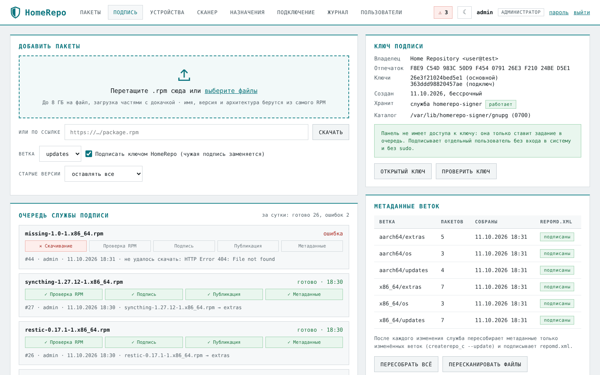
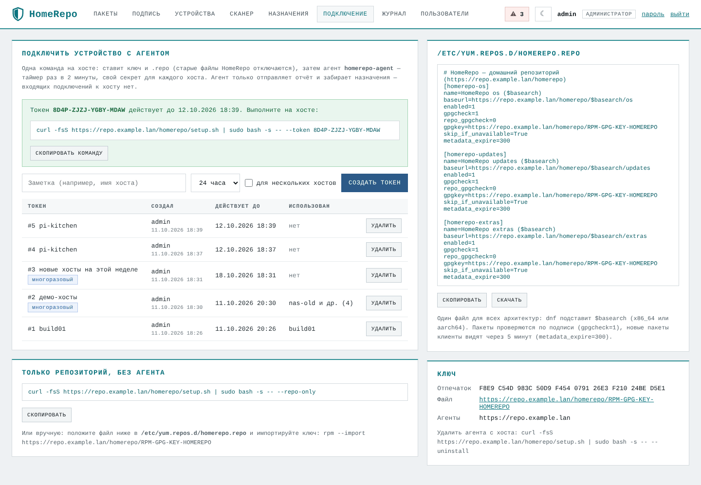
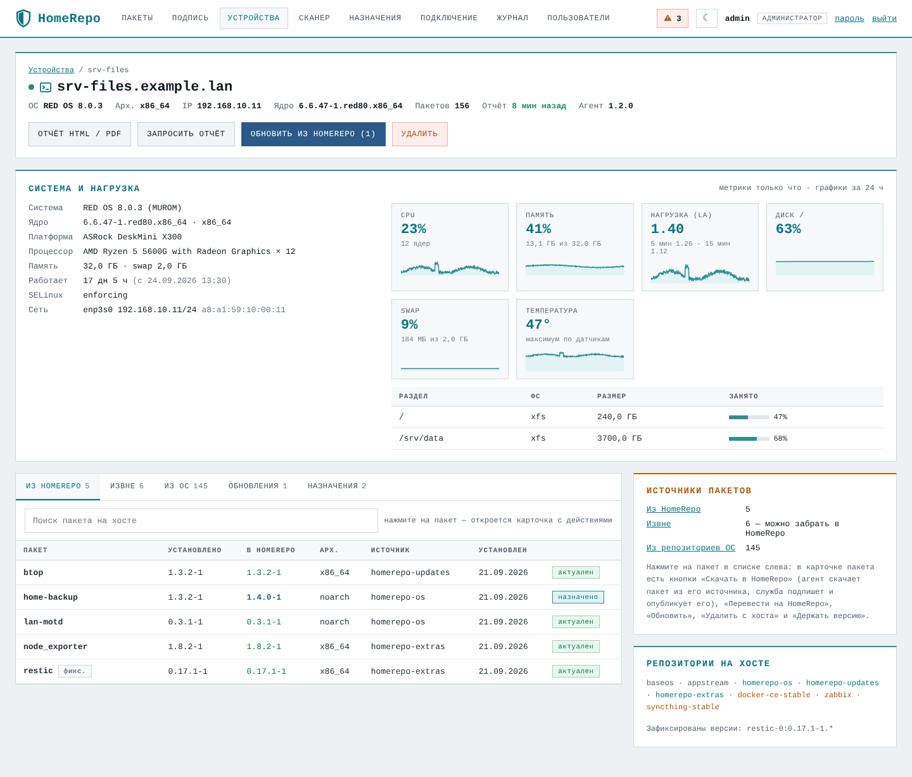
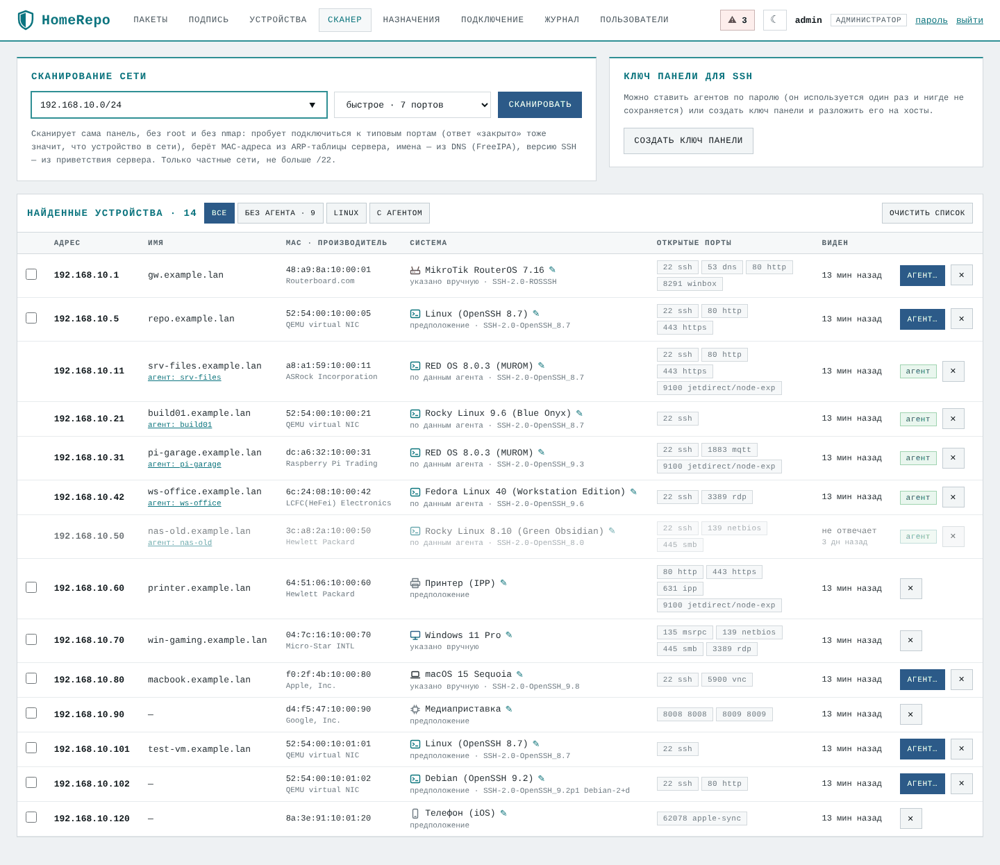
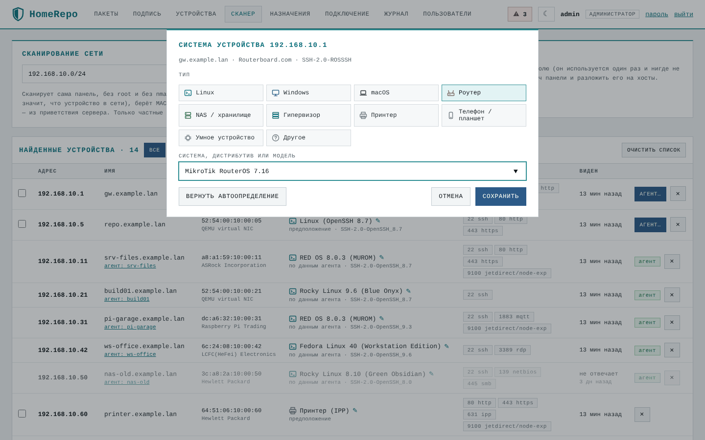
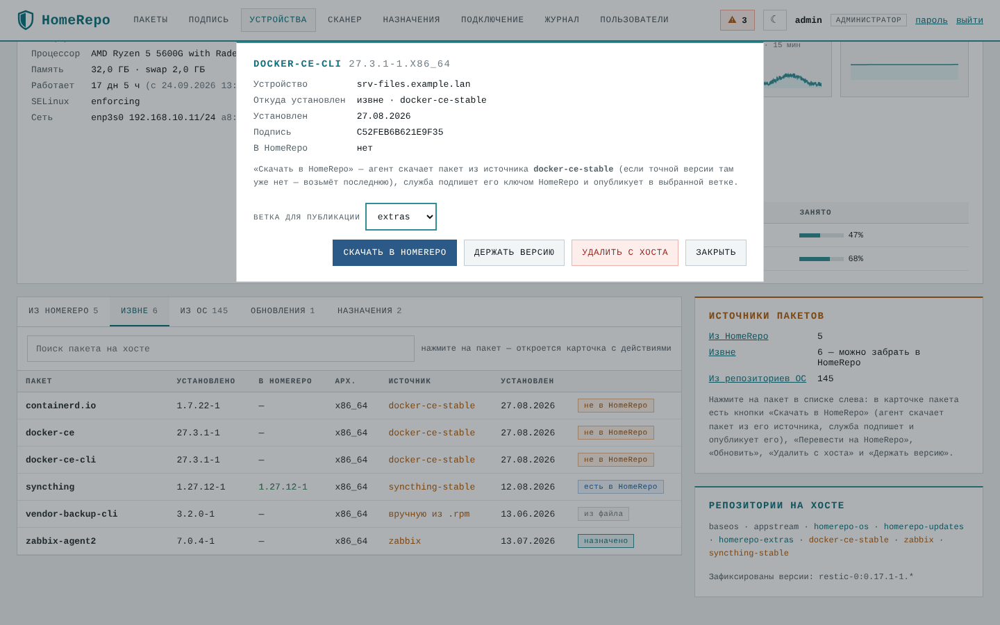
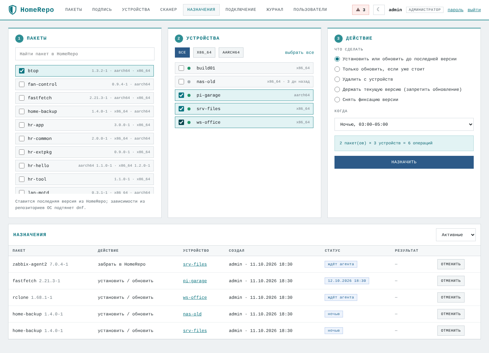
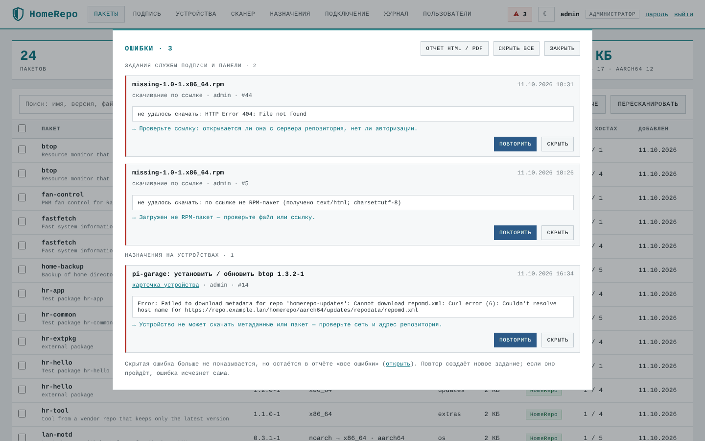
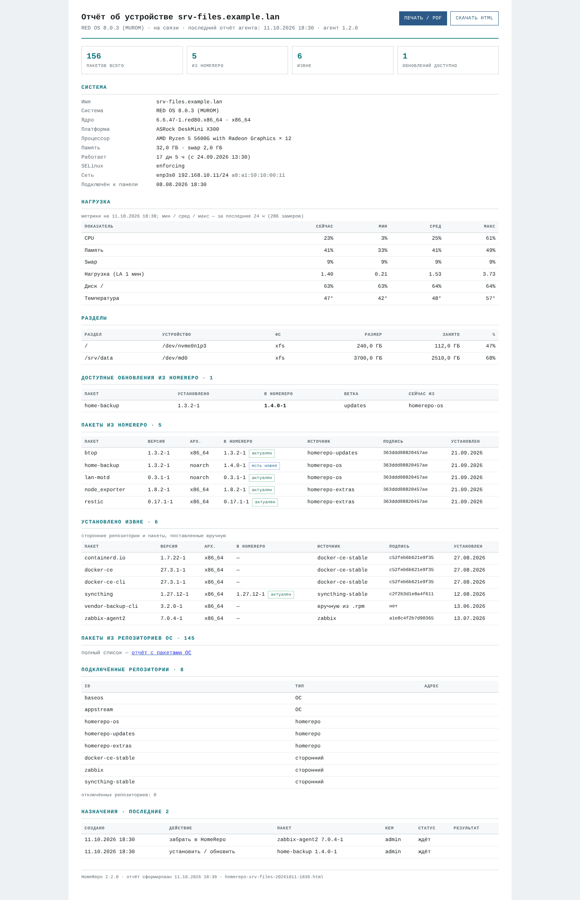

# HomeRepo: руководство по развёртыванию и использованию

Это руководство проводит от пустого сервера до работающего репозитория. В итоге у вас будут:

- подписанные пакеты в собственном RPM-репозитории;
- хосты, которые ставят из него пакеты с проверкой подписи;
- агенты, которые показывают, что и откуда установлено на каждом хосте;
- назначения, сканер сети и отчёты.

Во всех примерах ниже адреса и имена условные. Подставьте свои.

| В примерах | Что это | Где взять своё |
|---|---|---|
| `192.168.10.5` | IP сервера репозитория | `ip -4 addr` на сервере |
| `repo.example.lan` | DNS-имя сервера (если есть) | `hostname -f` |
| `192.168.10.0/24` | ваша домашняя или офисная подсеть | `ip route` |
| `admin` | первый пользователь панели | создаётся установщиком |

---

## 1. Как это устроено

```
 браузер ──HTTPS──► nginx ──► homerepo-web   (панель, 127.0.0.1:8090, пользователь homerepo)
                      │            │  кладёт задания в общую БД SQLite (группа homerepo)
 dnf на хостах ─HTTP──┤            ▼
   /homerepo/…        │      homerepo-signer  (служба подписи, пользователь homerepo-signer)
                      │        • единственный владелец секретного ключа GPG
                      └──────  • единственный, кто пишет в каталог репозитория
 агент на хосте ─HTTPS─► /api/agent/…   (свой секрет у каждого хоста)
```

- **Репозиторий** — обычный каталог с RPM и метаданными createrepo_c. Его раздаёт nginx (или Apache), клиенты ходят по HTTP. Целостность обеспечивается подписью пакетов и метаданных, а не HTTPS.
- **Панель** — веб-интерфейс на системном Python, без сторонних библиотек. Она не работает от root, не использует sudo и не имеет доступа к ключу подписи.
- **Служба подписи** проверяет пакеты, подписывает их, раскладывает по веткам и архитектурам, пересобирает метаданные и подписывает `repomd.xml`.
- **Агент** — один файл на Python. Раз в 2 минуты он опрашивает панель: присылает метрики, раз в 15 минут — список пакетов, забирает и выполняет назначения. Входящих подключений к хосту нет.

Структура репозитория:

```
/var/www/html/repos/homerepo/
├── RPM-GPG-KEY-HOMEREPO        открытый ключ для клиентов
├── x86_64/{os,updates,extras}/ пакеты + repodata/ (repomd.xml и repomd.xml.asc)
└── aarch64/{os,updates,extras}/
```

Пакет `noarch` автоматически публикуется во все архитектуры (жёсткой ссылкой, места не занимает). Набор веток и архитектур задаётся в настройках.

---

## 2. Требования

**Сервер репозитория**

- РЕД ОС 7.3 / 8, Rocky / AlmaLinux / RHEL 8–9, Fedora (x86_64 или aarch64 — подойдёт и Raspberry Pi 4/5).
- Python 3.7+ с модулем `rpm` (пакет `python3-rpm`, обычно уже стоит вместе с dnf).
- Пакеты `createrepo_c`, `gnupg2`, `openssl`, `openssh-clients`. Установщик доставит недостающие сам, а также поставит `nginx`, если выберете его.
- Порты 80 и 443 свободны или заняты старым Apache, который установщик заменит.
- Место под пакеты плюс запас: загрузка временно занимает ещё один размер файла.

**Хосты-клиенты**

- Любые RPM-системы с dnf (РЕД ОС, Rocky, Alma, Fedora…).
- Для агента нужны Python 3.6+ (есть везде, где есть dnf), `curl` и systemd.
- Хосты должны видеть сервер по HTTP (80) и HTTPS (443).

---

## 3. Быстрый старт

На сервере, от пользователя с sudo:

```bash
curl -LO https://github.com/ArsIS-02/HomeRepo/releases/latest/download/homerepo.tar.gz
tar xzf homerepo.tar.gz && cd homerepo-*/
sudo ./deploy/install.sh --check      # проверка и план; ничего не меняет
sudo ./deploy/install.sh              # установка
```

Или из git:

```bash
git clone https://github.com/ArsIS-02/HomeRepo.git && cd HomeRepo
sudo ./deploy/install.sh --check && sudo ./deploy/install.sh
```

В конце установщик выведет:

```
Панель:        https://192.168.10.5/
Вход:          admin / Xq7…  ← временный пароль, панель попросит сменить
Репозиторий:   http://192.168.10.5/homerepo
```

Дальше:

1. Откройте панель и смените пароль. Сертификат самоподписанный, поэтому браузер один раз предупредит — это нормально.
2. В разделе **«Подпись»** загрузите первые RPM.
3. В разделе **«Подключение»** создайте токен и выполните показанную команду на каждом хосте.

---

## 4. Установка подробно

### 4.1. Проверка перед установкой

```bash
sudo ./deploy/install.sh --check
```

Установщик покажет:

- ОС и Python, каких пакетов не хватает;
- адрес репозитория для клиентов и откуда он взялся;
- что будет с ключом подписи: создание, импорт или перенос;
- какой веб-сервер будет использован и что из старой системы будет отключено.

Ничего не меняется, пока не запустите без `--check`.

### 4.2. Параметры установщика

| Параметр | Зачем |
|---|---|
| `--repo-url URL` | Адрес, по которому хосты будут ходить в репозиторий, например `http://repo.example.lan/homerepo`. По умолчанию — `http://<IP сервера>/homerepo` или адрес из уже существующего `/etc/yum.repos.d/homerepo.repo`. Лучше сразу указать DNS-имя, если оно у вас есть. |
| `--repo-root DIR` | Каталог репозитория (по умолчанию `/var/www/html/repos/homerepo`). Если там уже лежат RPM в структуре `<arch>/<ветка>/`, они подхватятся. |
| `--web nginx\|httpd` | Веб-сервер. По умолчанию nginx; если он не ставится, остаётся Apache. Если Apache обслуживает ещё какие-то сайты, установщик его не тронет — тогда выбирайте сами. |
| `--key-name "Имя <почта>"` | Владелец нового ключа подписи (если ключ создаётся). |
| `--import-key FILE` | Использовать готовый ключ: файл из `gpg --armor --export-secret-keys ID`. |
| `--key-id ID` / `--old-gnupg DIR` | Перенести ключ из существующего каталога GnuPG (например, от старой самописной панели). |
| `--yes` | Не спрашивать подтверждение (для повторных запусков). |

### 4.3. Ключ подписи: три варианта

1. **Нового ключа нет — установщик создаст его сам.** Это RSA 4096 без пароля, владелец — служба подписи. Секретная копия кладётся в резервную копию установки `/var/backups/homerepo-<дата>/signing-key.secret.asc`. **Перенесите её в надёжное место вне сервера и удалите с сервера**: без неё при потере сервера придётся переподписывать все пакеты и заново раздавать ключ хостам.
2. **Свой ключ.** Сделайте экспорт на машине, где он лежит, и передайте файл на сервер:
   ```bash
   gpg --armor --export-secret-keys ВАШ_ID > signing.asc
   sudo ./deploy/install.sh --import-key signing.asc
   shred -u signing.asc
   ```
3. **Перенос из старой системы.** Если на сервере уже есть каталог GnuPG с ключом (например, `/usr/share/httpd/.gnupg`), установщик найдёт его сам или по `--old-gnupg` / `--key-id`. Старый каталог он уберёт в резервную копию.

**Ключ с паролем.** Положите пароль в файл `/etc/homerepo/signer.pass` (права: владелец `homerepo-signer`, режим `600`) **до** установки. Путь к файлу пропишется в настройки.

### 4.4. Что делает установщик

1. Резервная копия затрагиваемых файлов: конфиги веб-сервера, sudoers, unit-файлы — в `/var/backups/homerepo-<дата>/`.
2. Системные пользователи `homerepo` (панель) и `homerepo-signer` (подпись), код в `/opt/homerepo`, команда `homerepo`.
3. Ключ подписи — в `/var/lib/homerepo-signer/gnupg` (0700), репозиторий передаётся во владение `homerepo-signer`. Проверочная подпись.
4. `/etc/homerepo/homerepo.conf`, самоподписанный сертификат `/etc/homerepo/tls/` (в нём имена и IP сервера), службы `homerepo-signer` и `homerepo-web`.
5. Веб-сервер: nginx (`/etc/nginx/conf.d/homerepo.conf`) или Apache (`/etc/httpd/conf.d/homerepo.conf`). При SELinux включается `httpd_can_network_connect`, в firewalld открываются http и https.
6. Если есть старая система, она отключается и переносится в резервную копию. Сюда относятся каталог старой PHP-панели `/var/www/html/repos-web`, таймер `update-homerepo`, правила sudo для apache и скрипты в `/usr/local/bin`.
7. Сканирование репозитория, пересборка и подпись метаданных.

Повторный запуск безопасен: обновляет код и службы, настройки и данные не трогает.

**Где что лежит**

| Путь | Что |
|---|---|
| `/opt/homerepo/` | код (панель, служба, агент, веб-интерфейс) |
| `/etc/homerepo/homerepo.conf` | настройки |
| `/etc/homerepo/tls/server.{crt,key}` | сертификат панели |
| `/var/lib/homerepo/homerepo.db` | база: пользователи, устройства, задания, журнал |
| `/var/lib/homerepo/incoming/` | временные загрузки |
| `/var/lib/homerepo-signer/gnupg/` | ключ подписи (только служба подписи) |
| `/var/www/html/repos/homerepo/` | сам репозиторий |
| `/var/backups/homerepo-*/` | резервные копии установок, откат |

### 4.5. Пользователи и роли

| Роль | Может |
|---|---|
| наблюдатель | смотреть всё, открывать отчёты |
| оператор | загружать и подписывать пакеты, перемещать и удалять, назначать установку на хосты, создавать токены подключения |
| администратор | всё перечисленное, а также пользователей, сканирование сети, установку агентов по SSH и удаление устройств |

Новых пользователей создаёт администратор в разделе **«Пользователи»** или с сервера:

```bash
sudo homerepo user add ivan --role operator     # покажет временный пароль
sudo homerepo user passwd admin                 # сброс пароля (если забыли)
```

Правила паролей:

- не короче 10 символов, без имени пользователя;
- типовые пароли (`admin123`, `qwerty…`) не принимаются;
- 5 неверных попыток подряд блокируют вход на 15 минут.

---

## 5. Наполнение репозитория

### Ветки

По умолчанию ветки такие:

- `os` — базовые пакеты, которых нет в репозиториях дистрибутива;
- `updates` — обновления;
- `extras` — стороннее ПО: агенты мониторинга, браузеры, утилиты.

Состав веток можно изменить в `/etc/homerepo/homerepo.conf` (`branches = …`).

### Добавить пакеты

- **Через панель**, раздел «Подпись»: перетащите файлы `.rpm` (до 8 ГБ, загрузка частями с докачкой) или вставьте ссылку. Выберите ветку, подпись и сколько прошлых версий оставлять.
- **С сервера:**
  ```bash
  sudo homerepo add *.rpm --branch extras              # подписать и опубликовать
  sudo homerepo add pkg.rpm --branch updates --keep 2  # оставить 2 прошлые версии
  ```

Каждый пакет проходит четыре шага. Ход виден в очереди на странице «Подпись».

1. **Проверка** — заголовок и контрольные суммы. Битые и недокачанные файлы отклоняются.
2. **Подпись** — ключом репозитория; чужая подпись заменяется.
3. **Публикация** — в нужную архитектуру или во все (для noarch). Имя файла приводится к виду `имя-версия-релиз.арх.rpm`.
4. **Метаданные** — пересобираются только у изменённых веток, `repomd.xml` подписывается.

### Перенос существующего репозитория

Разложите RPM по каталогам `<repo-root>/<arch>/<ветка>/` и выполните:

```bash
sudo chown -R homerepo-signer: /var/www/html/repos/homerepo
sudo homerepo rescan       # пакеты появятся в панели, метаданные пересоберутся
sudo homerepo resign       # переподписать всё, что подписано не вашим ключом
```

Посторонние файлы в каталогах репозитория (не-RPM, остатки прерванных загрузок, устаревшие общие `repodata`) панель покажет как «мусор». Удаляются они кнопкой на странице «Подпись» или командой `homerepo cleanup`.



---

## 6. Подключение хостов

### С агентом (рекомендуется)

В панели откройте **«Подключение» → «Создать токен»**. Токен одноразовый и действует 24 часа; есть вариант «для нескольких хостов». На хосте выполните показанную команду:

```bash
curl -fsS http://192.168.10.5/homerepo/setup.sh | sudo bash -s -- --token ABCD-EFGH-JKLM-NPQR
```

Скрипт:

1. импортирует ключ репозитория;
2. записывает `/etc/yum.repos.d/homerepo.repo` — один файл на все архитектуры через `$basearch`; старые файлы с адресом `/homerepo/` отключаются;
3. ставит агента `/usr/local/libexec/homerepo-agent/` и таймер systemd;
4. регистрирует хост в панели. Хост получает свой секрет, а сертификат панели запоминается.

Через минуту хост появится в разделе «Устройства».

### Только репозиторий

```bash
curl -fsS http://192.168.10.5/homerepo/setup.sh | sudo bash -s -- --repo-only
```

Или вручную: скопируйте содержимое `.repo` со страницы «Подключение» в `/etc/yum.repos.d/homerepo.repo` и выполните `sudo rpm --import http://192.168.10.5/homerepo/RPM-GPG-KEY-HOMEREPO`.

### Что собирает агент

| Когда | Что |
|---|---|
| каждые 2 минуты | загрузка CPU, память, swap, LA, заполнение разделов, температура, время работы; заодно забирает назначения |
| раз в 15 минут и после назначений | все установленные пакеты и откуда каждый установлен (история dnf), подпись пакета, подключённые репозитории, сведения о системе: дистрибутив, ядро, модель платы, процессор, интерфейсы, SELinux |

Пакеты делятся на три группы:

- **из homerepo** — установлены из нашего репозитория или подписаны нашим ключом;
- **из ОС** — из репозиториев, объявленных пакетом дистрибутива (`system-release`), или подписаны ключом дистрибутива;
- **извне** — всё остальное: сторонние репозитории, `.rpm` вручную.

Агент обновляется сам, когда на сервере появляется новая версия.

Удалить агента с хоста (репозиторий останется подключён):

```bash
curl -fsS http://192.168.10.5/homerepo/setup.sh | sudo bash -s -- --uninstall
```





---

## 7. Сканер сети и установка агента по SSH

Раздел **«Сканер»** доступен только администратору. Он нужен, чтобы найти устройства в сети и поставить на них агента, не заходя на каждое вручную.

- Укажите подсеть, например `192.168.10.0/24`. Сканировать можно только частные сети и не больше /22.
- Выберите «быстрое» (7 портов) или «расширенное» (31 порт) сканирование.
- Сканирует сама панель, без root и без nmap. Она пробует TCP-подключения: ответ «порт закрыт» тоже означает, что устройство в сети. MAC-адреса берутся из ARP-таблицы сервера, имена — из DNS, версия SSH — из приветствия сервера.
- Тип системы определяется автоматически: у хостов с агентом — по его данным, у остальных — по приветствию SSH, портам и производителю сетевой карты. Его можно поправить вручную (✎): Linux с названием дистрибутива, Windows, macOS, роутер с его системой и т. д.
- **«Установить агента»** — панель подключается по SSH и выполняет команду подключения. Вход возможен двумя способами:
  - **по паролю** — пароль используется один раз и не сохраняется ни в базе, ни в журнале, ни на диске;
  - **ключом панели** — кнопка «Создать ключ панели», затем открытый ключ добавляется в `~/.ssh/authorized_keys` нужного пользователя на хостах.

  Нужен `root` или пользователь с sudo. Пароль sudo можно указать отдельно; для входа по ключу при `NOPASSWD` он не нужен.





---

## 8. Назначения

Раздел **«Назначения»**: выберите пакеты, устройства, действие и время выполнения.

- Действия:
  - **установить или обновить** до последней версии из HomeRepo;
  - **только обновить**, если пакет уже стоит;
  - **удалить**;
  - **держать версию** или **снять фиксацию** — через `dnf versionlock`; плагин агент поставит сам.
- Время: при следующем опросе (до 2 минут), ночью (03:00–05:00) или к заданному моменту.

Если для архитектуры устройства нет нужной сборки, назначение не создаётся, и панель об этом скажет. Если устройство не на связи, назначение выполнится, когда агент выйдет на связь. Результат и вывод `dnf` видны в таблице назначений и в карточке устройства.

Действия с одним пакетом удобнее выполнять из карточки устройства. Пакеты там разложены по вкладкам «Из HomeRepo», «Извне» и «Из ОС», а над списком есть поиск. Нажмите на пакет, и откроется его карточка: откуда он установлен, чем подписан, какая версия есть в HomeRepo. Под этими сведениями — кнопки:

- **«Скачать в HomeRepo»** — забрать пакет, установленный извне. Ветку публикации выбирают в карточке, по умолчанию это `extras`.
  - Агент скачает тот же пакет из его источника и отправит в панель, служба подпишет и опубликует его.
  - Сторонние репозитории часто хранят только последнюю версию. Если установленной там уже нет, берётся последняя из того же репозитория, и об этом пишется в результате назначения.
  - Ход виден по статусам: «выполняется» (на устройстве) → «в подписи» → «выполнено» с итогом публикации.
  - Пакет, поставленный вручную из файла (`@commandline`), скачать неоткуда. Вместо этой кнопки будет «Загрузить .rpm в панель».
- **«Перевести на HomeRepo»** — переустановить ту же версию из HomeRepo, чтобы дальше пакет обновлялся оттуда.
- **«Обновить до …»** — поставить более новую версию из HomeRepo.
- **«Держать версию»** / **«Снять фиксацию»**, **«Удалить с хоста»**.

Если по пакету уже есть назначение, карточка покажет его статус. Пока назначение ждёт агента, его можно отменить из той же карточки.





### Ошибки

Если в работе что-то пошло не так, в шапке панели появляется красный значок **⚠ N**. Ошибкой считается:

- задание службы подписи, завершившееся неудачей;
- неудавшееся назначение на устройстве;
- остановка службы подписи или недоступность ключа.

По щелчку открывается окно со списком ошибок. У каждой показан текст ошибки (для назначений — вывод `dnf`) и подсказка, что сделать.

- **Повторить** — создаёт новое задание или назначение. Если оно пройдёт, ошибка исчезнет сама.
- **Скрыть** — ошибка просмотрена и больше не показывается.
- **Отчёт HTML / PDF** — все непросмотренные ошибки одной страницей. Со скрытыми: `/api/report/errors.html?all=1`.

Ошибки старше 30 дней не показываются.



---

## 9. Отчёты

- **Карточка устройства → «Отчёт HTML / PDF»** — отчёт по хосту:
  - система, нагрузка (сейчас и мин / сред / макс за сутки), разделы;
  - обновления, пакеты из HomeRepo и извне;
  - подключённые репозитории и назначения.
- **«Устройства» → «Сводный отчёт»** — таблица по всем хостам.

Отчёт можно скачать одним HTML-файлом или напечатать в PDF через печать браузера («Печать / PDF» → «Сохранить как PDF»).



---

## 10. HTTPS и свой сертификат

По умолчанию у панели самоподписанный сертификат на имена и IP сервера. Агенты доверяют ему, потому что `setup.sh` кладёт его в `/etc/homerepo-agent/ca.pem`.

Чтобы перейти на сертификат своего центра сертификации (например, FreeIPA):

1. Получите сертификат и ключ для имени сервера. Для FreeIPA (сервер должен быть клиентом домена):
   ```bash
   # при включённом SELinux certmonger может писать только в каталоги с меткой cert_t
   sudo semanage fcontext -a -t cert_t '/etc/homerepo/tls(/.*)?' && sudo restorecon -R /etc/homerepo/tls
   sudo ipa-getcert request -K HTTP/repo.example.lan -D repo.example.lan \
        -f /etc/homerepo/tls/server.crt -k /etc/homerepo/tls/server.key \
        -C "systemctl reload nginx"
   ```
   certmonger сам продлевает сертификат и перезагружает nginx.
2. Укажите в `/etc/homerepo/homerepo.conf`, в разделе `[agent]`: `ca_file = /etc/ipa/ca.crt`. Тогда новые хосты будут получать CA, а не сам сертификат.
3. Перезапустите веб-сервер: `sudo systemctl reload nginx`.

Уже подключённые агенты доверяют и системному хранилищу сертификатов. На клиентах FreeIPA CA домена в нём уже есть, поэтому переподключать их не нужно. Для хостов вне домена выполните `setup.sh` с новым токеном: хост останется тем же устройством, его узнают по machine-id.

---

## 11. Настройки (`/etc/homerepo/homerepo.conf`)

```ini
[repo]
root = /var/www/html/repos/homerepo     ; каталог репозитория
url = http://192.168.10.5/homerepo      ; адрес для клиентов (попадает в .repo и setup.sh)
arches = x86_64 aarch64                 ; обслуживаемые архитектуры
branches = os updates extras            ; ветки
default_branch = updates
repo_gpgcheck = no                      ; yes — клиенты проверяют и подпись метаданных

[panel]
listen = 127.0.0.1                      ; панель слушает только локально, снаружи — через nginx
port = 8090
public_url = https://192.168.10.5
session_hours = 12
upload_max_gb = 8

[signer]
gnupg_home = /var/lib/homerepo-signer/gnupg
key_id = <отпечаток ключа>
passphrase_file =                       ; /etc/homerepo/signer.pass, если у ключа есть пароль
sign_metadata = yes                     ; подписывать repomd.xml
workers = 2                             ; потоки createrepo_c

[agent]
api_url = https://192.168.10.5          ; куда агенты отправляют отчёты
ca_file = /etc/homerepo/tls/server.crt  ; что получают агенты как доверенный сертификат
interval = 120                          ; опрос, секунд
report_every = 900                      ; полный отчёт о пакетах, секунд
```

После изменений: `sudo systemctl restart homerepo-web homerepo-signer`. Если менялся `url`, переподключите хосты (`setup.sh`) или поправьте у них `/etc/yum.repos.d/homerepo.repo`.

---

## 12. Безопасность

- Ключ подписи доступен только пользователю `homerepo-signer`: без входа в систему, без sudo, служба изолирована systemd. Взлом панели не даёт украсть ключ.
- Панель работает от непривилегированного пользователя и слушает только `127.0.0.1`.
- Пароли хранятся как хеши scrypt. Сессии — HttpOnly и SameSite=Strict, изменяющие запросы защищены CSRF-токеном.
- У каждого агента свой секрет, в базе хранится только его хеш. Удалённое из панели устройство перестаёт авторизоваться.
- SSH-пароли для установки агентов нигде не сохраняются.
- В журнале записывается каждое действие: кто, что, когда и с какого адреса.

Рекомендации:

- держите копию секретного ключа вне сервера;
- не открывайте панель в интернет;
- ограничьте доступ к 443 своей сетью;
- по возможности замените самоподписанный сертификат на сертификат своего центра (раздел 10).

---

## 13. Резервное копирование и перенос на другой сервер

Сохраните:

```bash
sudo systemctl stop homerepo-web homerepo-signer
sudo tar czf homerepo-backup.tgz /etc/homerepo /var/lib/homerepo /var/lib/homerepo-signer
# сам репозиторий (может быть большим):
sudo tar cf homerepo-packages.tar -C /var/www/html/repos homerepo
sudo systemctl start homerepo-signer homerepo-web
```

На новом сервере:

1. Распакуйте архивы на те же места.
2. Запустите `sudo ./deploy/install.sh --yes`. Он увидит, что ключ уже у службы подписи, и ничего не перезапишет.
3. Если сменился адрес сервера, поправьте `url`, `public_url` и `api_url` в настройках.

---

## 14. Обновление, откат, удаление

**Обновление.** Скачайте новую версию и запустите установщик ещё раз:

```bash
tar xzf homerepo-X.Y.Z.tar.gz && cd homerepo-X.Y.Z && sudo ./deploy/install.sh --yes
grep VERSION /opt/homerepo/lib/homerepo/__init__.py
```

База обновляется автоматически, агенты обновятся сами.

**Откат** к состоянию до установки — каждая установка оставляет резервную копию:

```bash
sudo /opt/homerepo/deploy/rollback.sh /var/backups/homerepo-<дата>
```

**Удаление:**

```bash
sudo systemctl disable --now homerepo-web homerepo-signer
sudo rm -f /etc/systemd/system/homerepo-*.service /etc/nginx/conf.d/homerepo.conf /usr/local/bin/homerepo
sudo systemctl daemon-reload && sudo systemctl reload nginx
sudo rm -rf /opt/homerepo                 # код
# данные и ключ — только если они точно больше не нужны:
# sudo rm -rf /etc/homerepo /var/lib/homerepo /var/lib/homerepo-signer
```

---

## 15. Решение проблем

| Симптом | Что проверить |
|---|---|
| Панель не открывается | `systemctl status homerepo-web nginx`, `journalctl -u homerepo-web -n 50`, `curl -s http://127.0.0.1:8090/api/me` (ожидается 401) |
| «Служба подписи не отвечает» | `systemctl status homerepo-signer`, `journalctl -u homerepo-signer -n 50` |
| Задание падает на шаге «Подпись» | `sudo homerepo status`: виден ли ключ? Ключ с паролем — нужен `passphrase_file`. |
| `dnf`: «GPG check FAILED» / «Public key not installed» | На хосте: `rpm --import http://<сервер>/homerepo/RPM-GPG-KEY-HOMEREPO`. В панели не должно оставаться пакетов с чужой подписью. |
| `dnf` не видит новый пакет | Метаданные кэшируются до 5 минут (`metadata_expire=300`). Ускорить: `dnf --refresh …`. |
| Хост не появляется после `setup.sh` | На хосте: `journalctl -u homerepo-agent -n 30`; доступен ли `https://<сервер>/` (`curl -k`); не истёк ли токен. |
| Агент: «certificate verify failed» | Сменился сертификат панели — см. раздел 10. |
| Установка по SSH: «Permission denied» | Неверный пароль, вход root по паролю запрещён (`PermitRootLogin`), или ключ панели не добавлен на хост. |
| Установка по SSH: «sudo требует пароль» / «must have a tty» | Укажите пароль sudo. Для `requiretty` используйте root или отключите эту настройку для пользователя. |
| В сканере нет MAC-адресов | MAC видны только для устройств в той же подсети, что и сервер (через маршрутизатор ARP не проходит). |
| На сервере включён SELinux, nginx отдаёт 502 | `getsebool httpd_can_network_connect` должен быть `on` (установщик включает). |

Полезные команды:

```bash
sudo homerepo status          # службы, ключ, пакеты, очередь
sudo homerepo jobs            # последние задания
sudo homerepo rescan          # пересканировать файлы и пересобрать метаданные
journalctl -u homerepo-web -u homerepo-signer -f
```
